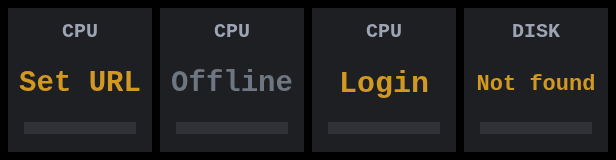
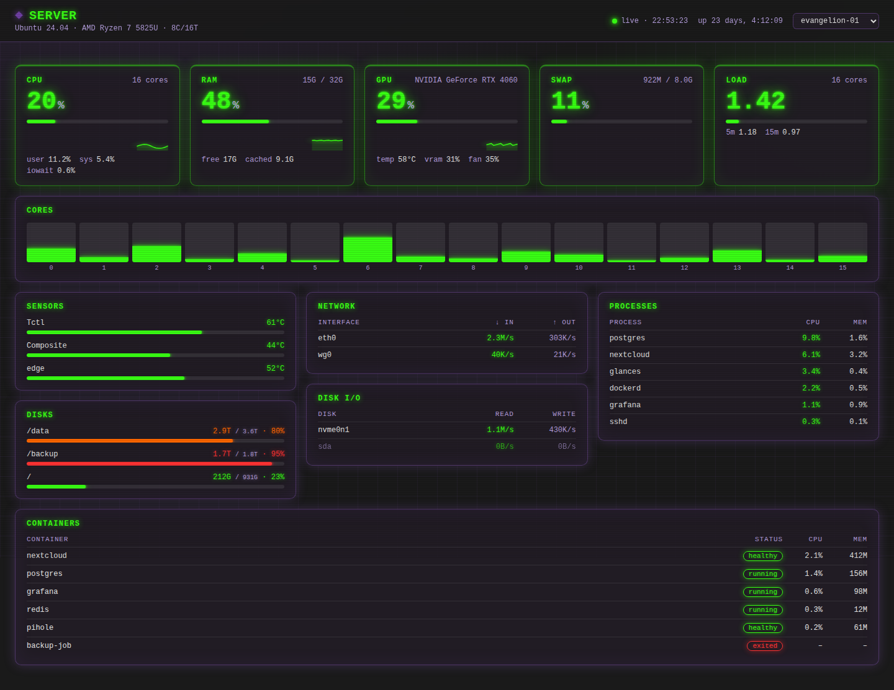

# Glances Monitor for Ulanzi Studio

A Ulanzi Studio plugin that shows live metrics of any server that runs [Glances](https://github.com/nicolargo/glances) on the keys of a Ulanzi deck. Each key shows one metric and updates by itself.


## Features

- Nine metrics: CPU, memory, swap, load (1 minute), disk, network, temperature, GPU usage, and GPU temperature.
- Glances 4 (API v4) and Glances 3 (API v3). The plugin finds the API version by itself.
- Password login (HTTP Basic) for servers that run Glances with `--password`. Glances 4 only.
- Disk, network, temperature, and GPU keys can show a specific partition, interface, sensor, or GPU. The settings form lists what the server has. "Auto" picks the root partition, the busiest physical interface, the CPU sensor, and the first GPU (for GPU temperature, the first GPU that reports one).
- Colors by level: green, amber, red. You can set the two limits for each key. Temperature keys use the sensor's own limits when Glances reports them.
- A clear state on each key when something is wrong:



- One request per server and metric, even when many keys show the same data.
- A key stops polling when it is not on the visible page. A key press forces a refresh.
- User interface in English, Portuguese, Spanish, German, Simplified Chinese, Traditional Chinese, Japanese, and Korean.

## Requirements

- Ulanzi Studio on Windows or macOS.
- Glances in web server mode on each server, reachable from the computer that runs Ulanzi Studio.

## 1. Run Glances on the server

Install Glances with the web extra. This example uses `uv` and needs no root access:

```
uv tool install 'glances[web]'
```

Start the web server:

```
glances -w
```

To keep it running, use the systemd user unit in [`examples/glances.service`](examples/glances.service). Copy it to `~/.config/systemd/user/glances.service`, replace `<SERVER_IP>`, and start it:

```
systemctl --user daemon-reload && systemctl --user enable --now glances
```

The service keeps running after you log out only when linger is on for your user (`loginctl enable-linger`). The example unit refreshes every 5 seconds, turns off the Glances plugins that the deck does not use, and caps memory at 256 MB. On a 16-core server it used 0.6% of one core and 62 MB of RAM.

Check the API from the deck computer:

```
curl http://<SERVER_IP>:61208/api/4/cpu/total
```

### Security

Without a password, Glances sends `Access-Control-Allow-Origin: *`. Any web page that you open on a computer that can reach the server can then read its metrics. Do one or both of these:

- Bind Glances to a private address only, such as a LAN or Tailscale IP. Never expose it to the internet.
- Start Glances with `--password`. Glances asks for a password and can save it, so the service starts without a prompt. The default user name is `glances`. Put the same user name and password in the key settings.

Ulanzi Studio stores the key settings, including the password, on the deck computer in plain text. Use a password that you do not use anywhere else.

## 2. Install the plugin

1. Close Ulanzi Studio, including the tray icon.
2. Copy the `com.ulanzi.glancesmonitor.ulanziPlugin` folder into the plugins folder:
   - Windows: `%APPDATA%\Ulanzi\UlanziDeck\Plugins\`
3. Open Ulanzi Studio. Find the **Glances Monitor** category and drag **Server metric** to a key.
4. In the key settings, enter the Glances URL, for example `http://192.168.1.10:61208`. The form shows "Connected to Glances API v4" when the plugin can read the server.
5. Choose the metric. For disk, network, temperature, and GPU, choose a target or keep "Auto".

If the category does not appear, read the plugin log at `%APPDATA%\Ulanzi\UlanziDeck\logs\com.ulanzi.ulanzistudio.glancesmonitor.log`.

## Optional: a neon web dashboard for Glances

`glances-webui/` replaces the Glances browser page with one dashboard: CPU, RAM, GPU, swap and load gauges with history, per-core bars, sensors, disks, network, disk I/O, top processes and containers. Panels with no data stay hidden. It has four color themes, picked in the page header. It uses the same URL and the same login as Glances, and it reads only the Glances API.



1. Copy the `glances-webui` folder to the server.
2. Add its path to the `[outputs]` section of `glances.conf` (`~/.config/glances/` on Linux, `%APPDATA%\glances\` on Windows):

   ```ini
   [outputs]
   webui_root_path=/path/to/glances-webui
   ```

3. Restart Glances. To get the original page back, remove the line and restart again.

## Key states

| Key shows | Cause | Fix |
|---|---|---|
| Set URL | The key has no Glances URL | Enter the URL in the key settings |
| Offline | No answer within 4 seconds | Check that Glances runs and that the deck computer can reach the address |
| Login | Glances refused the user name or password | Check the user name and password. Glances 3 does not support login from the plugin |
| Not found | The partition, interface, sensor, or GPU does not exist | Choose another target, or "Auto" |
| No data | The server has no data for this metric, for example no GPU | Choose another metric |
| Not Glances | The URL answers, but not with the Glances API | Check the port. The Glances default is 61208 |

## Development

| Path | Content |
|---|---|
| `com.ulanzi.glancesmonitor.ulanziPlugin/manifest.json` | Plugin and action definition |
| `com.ulanzi.glancesmonitor.ulanziPlugin/plugin/metrics.js` | Metric parsing, target choice, levels. No browser APIs, so Node can test it |
| `com.ulanzi.glancesmonitor.ulanziPlugin/plugin/glances.js` | Glances client: API version detection, login, request sharing |
| `com.ulanzi.glancesmonitor.ulanziPlugin/plugin/render.js` | Key drawing and key state text |
| `com.ulanzi.glancesmonitor.ulanziPlugin/plugin/app.js` | Main service: key lifecycle and polling schedule |
| `com.ulanzi.glancesmonitor.ulanziPlugin/property-inspector/` | Key settings form |
| `com.ulanzi.glancesmonitor.ulanziPlugin/*.json` | Translations |
| `com.ulanzi.glancesmonitor.ulanziPlugin/libs/` | Official Ulanzi SDK, unchanged |
| `tests/` | Unit tests with real Glances 3 and Glances 4 responses |
| `make_icons.py` | Generates the plugin icons (`uv run --with pillow python make_icons.py <icons dir>`) |

Run the tests with Node 20 or later:

```
npm test
```

## License

MIT, see [LICENSE](LICENSE). The files in `com.ulanzi.glancesmonitor.ulanziPlugin/libs/` come from the [Ulanzi plugin SDK](https://github.com/UlanziTechnology/UlanziDeckPlugin-SDK) and keep their Apache 2.0 license, see [`libs/LICENSE-ulanzi-sdk`](com.ulanzi.glancesmonitor.ulanziPlugin/libs/LICENSE-ulanzi-sdk).
