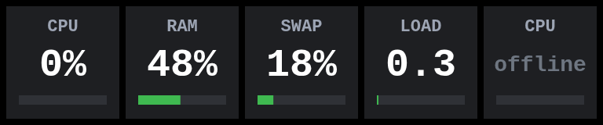

# Homelab Stats for Ulanzi Studio

A Ulanzi Studio plugin that shows the CPU, RAM, swap, or load of a remote Linux server on a key of the Ulanzi D200 deck. The key updates by itself. The data comes from the [Glances](https://github.com/nicolargo/glances) REST API.



## What a key shows

- The metric name, the current value, and a bar.
- The bar is green below 70%, amber from 70% to 90%, and red from 90%.
- "offline" in grey when the server does not answer within 4 seconds.

Each key has three settings: the metric (CPU, RAM, swap, or load over 1 minute), the Glances URL, and the refresh interval (2, 5, 10, or 30 seconds). A key stops polling when it is not on the visible page. A key press forces a refresh.

## Why a plugin

The built-in "API Request" action of Ulanzi Studio shows the response only when you press the key. Its periodic poll only switches the key between two states. It cannot show a live number.

## Requirements

- Ulanzi Studio on Windows or macOS.
- Glances 4 in web server mode on the server, reachable from the computer that runs Ulanzi Studio.

## 1. Run Glances on the server

Install Glances with the web extra. This example uses `uv` and needs no root access:

```
uv tool install 'glances[web]'
```

Run it as a systemd user service. Copy [`examples/glances.service`](examples/glances.service) to `~/.config/systemd/user/glances.service`. Replace `<SERVER_IP>` with the address the deck computer uses to reach the server, for example a Tailscale or LAN address. Then start it:

```
systemctl --user daemon-reload && systemctl --user enable --now glances
```

To keep the service running after you log out, linger must be on for your user (`loginctl enable-linger`).

Check the API from the deck computer:

```
curl http://<SERVER_IP>:61208/api/4/cpu/total
```

The example service refreshes every 5 seconds, turns off the plugins that the deck does not use, and caps memory at 256 MB. On a 16-core server it used 0.6% of one core and 62 MB of RAM.

Glances has no authentication in this mode. Bind it to a private address only, such as a Tailscale or LAN IP. Do not expose it to the internet.

## 2. Install the plugin

1. Close Ulanzi Studio, including the tray icon.
2. Copy the `local.homelab.stats.ulanziPlugin` folder into the plugins folder:
   - Windows: `%APPDATA%\Ulanzi\UlanziDeck\Plugins\`
3. Open Ulanzi Studio. Find the **Homelab Stats** category and drag **Homelab metric** to a key.
4. In the key settings, set the Glances URL to `http://<SERVER_IP>:61208` and choose the metric.

If the category does not appear, read the plugin log at `%APPDATA%\Ulanzi\UlanziDeck\logs\local.homelab.ulanzistudio.stats.log`.

## Project layout

| Path | Content |
|---|---|
| `local.homelab.stats.ulanziPlugin/manifest.json` | Plugin and action definition |
| `local.homelab.stats.ulanziPlugin/plugin/` | Main service: polling and key drawing |
| `local.homelab.stats.ulanziPlugin/property-inspector/` | Key settings form |
| `local.homelab.stats.ulanziPlugin/libs/` | Official Ulanzi SDK, unchanged |
| `make_icons.py` | Generates the plugin icons (`uv run --with pillow python make_icons.py <icons dir>`) |
| `examples/glances.service` | systemd user unit for Glances |

## License

MIT, see [LICENSE](LICENSE). The files in `local.homelab.stats.ulanziPlugin/libs/` come from the [Ulanzi plugin SDK](https://github.com/UlanziTechnology/UlanziDeckPlugin-SDK) and keep their Apache 2.0 license, see [`libs/LICENSE-ulanzi-sdk`](local.homelab.stats.ulanziPlugin/libs/LICENSE-ulanzi-sdk).
